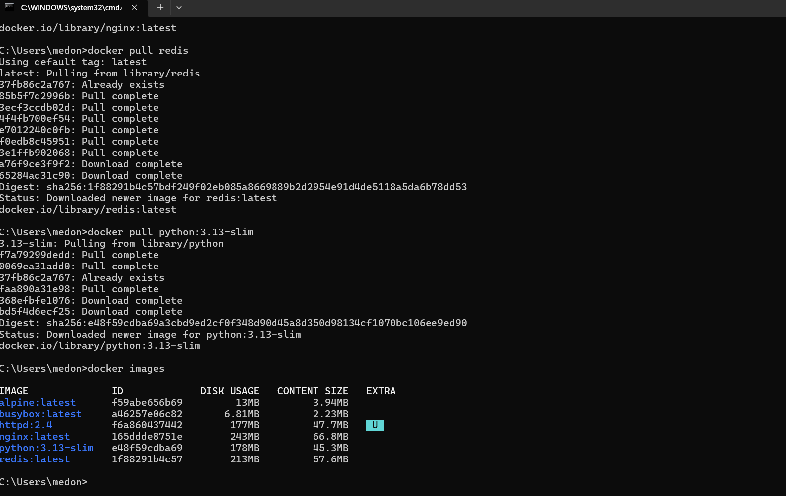
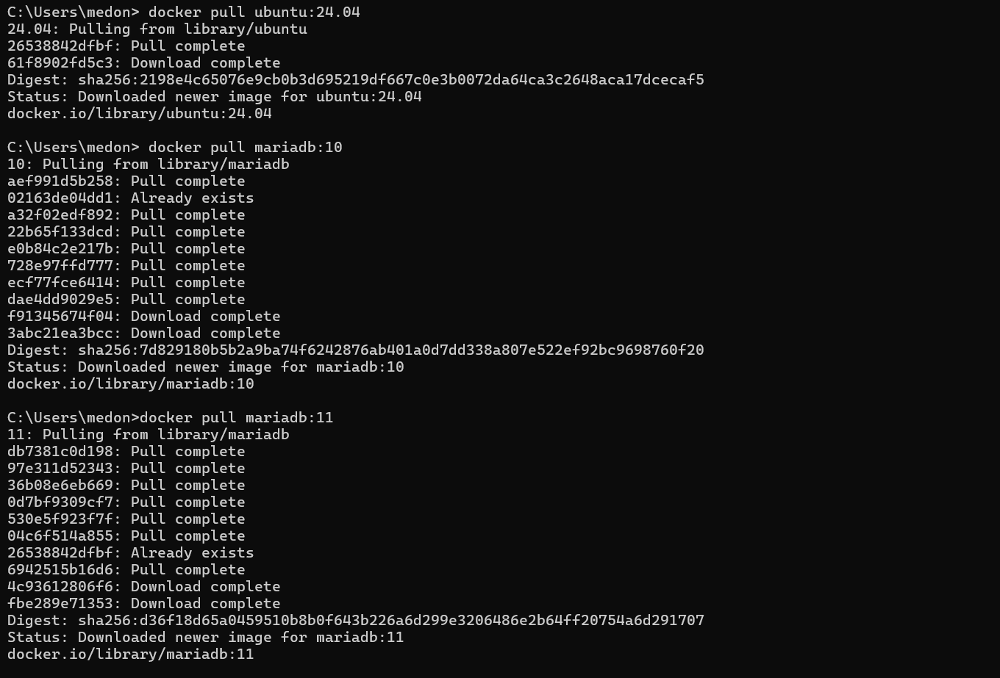
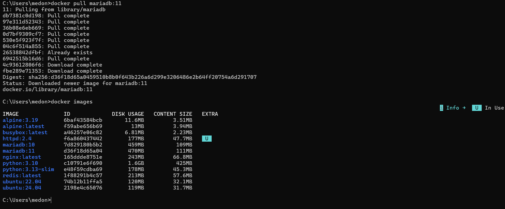
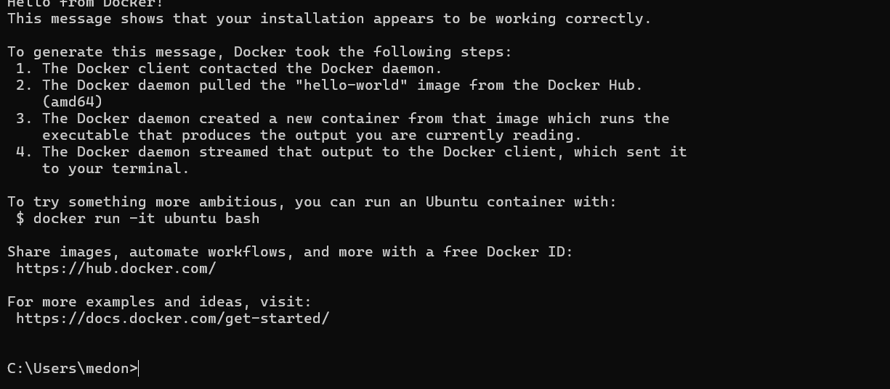
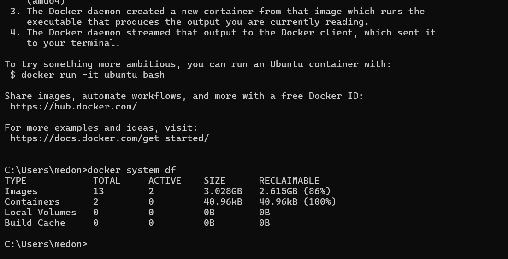
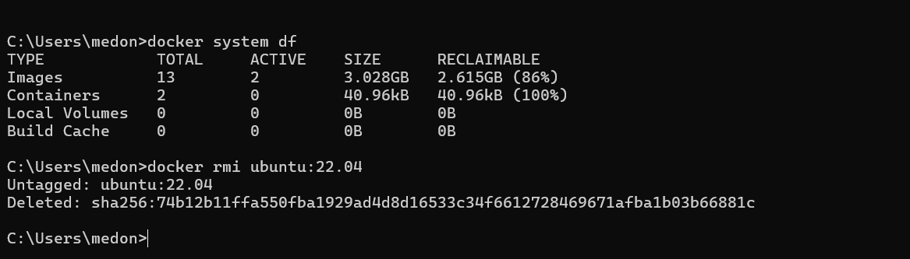
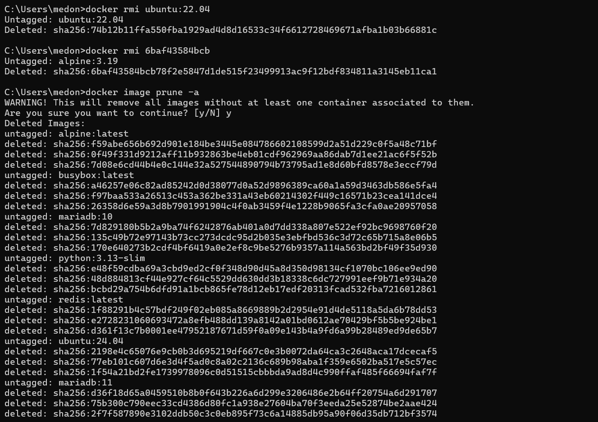
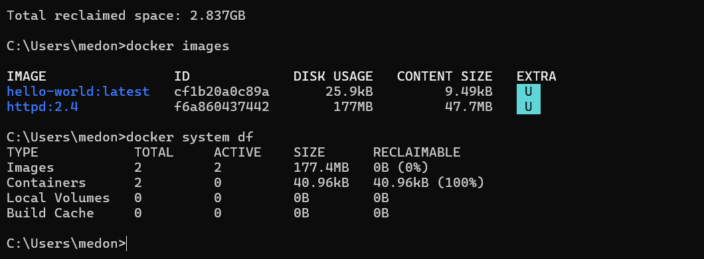

# ДЗ Docker: образи, теги, прибирання

## 1. Паспорт образів

Завантажені образи: `alpine`, `busybox`, `nginx`, `redis`, `python:3.13-slim`.

| Образ | Тег | Розмір на диску | Для чого потрібен |
|---|---|---|---|
| busybox | latest | 6.81 MB | Набір базових Unix-утиліт (sh, ls, cp, wget…) в одному файлі. Для тестів і дуже малих контейнерів. |
| alpine | latest | 13 MB | Мінімальний дистрибутив Linux (musl + BusyBox). База для легких образів. |
| python | 3.13-slim | 178 MB | Python 3.13 на урізаному Debian. Для запуску Python-застосунків. |
| redis | latest | 213 MB | Сховище даних у пам'яті (ключ–значення): кеш, черги, сесії. |
| nginx | latest | 243 MB | Веб-сервер, reverse proxy, балансувальник навантаження. |

**Висновок.** Найлегший образ — busybox (6.81 MB): у ньому немає повноцінної ОС, лише один файл з утилітами. Alpine теж дуже легкий (13 MB), бо це мінімальний Linux без зайвих програм.
Найважчий — nginx (243 MB). Він побудований на Debian, тобто містить базову систему з бібліотеками і сам веб-сервер. Redis і python-slim теж на Debian, тому вони в 15–20 разів важчі за alpine.
Redis і python мають спільний шар `37fb86c2a767` (під час завантаження він був `Already exists`): Docker не завантажує однакові шари двічі.

## 2. Полювання на версії

| Образ | Тег | Розмір | Чим відрізняється |
|---|---|---|---|
| python | 3.10 | 1.6 GB | Стара версія Python, повний образ (з компіляторами та dev-бібліотеками), тому в 9 разів важчий за 3.13-slim. |
| alpine | 3.19 | 11.6 MB | Конкретний старіший реліз, на відміну від latest не зміниться з часом. |
| ubuntu | 22.04 | 120 MB | Ubuntu 22.04 LTS (Jammy), старіші версії пакетів. |
| ubuntu | 24.04 | 119 MB | Ubuntu 24.04 LTS (Noble), новіші версії пакетів. |
| mariadb | 10 | 459 MB | Остання версія гілки MariaDB 10.x. |
| mariadb | 11 | 470 MB | Остання версія гілки MariaDB 11.x. Побудована на Ubuntu 24.04 (спільний шар `26538842dfbf`). |

**Коментар.** Тег визначає версію образу. `latest` змінюється з часом, тому в проєктах краще писати конкретний тег, щоб збірка завжди була однаковою. Суфікс `-slim` означає урізаний образ: python:3.10 займає 1.6 GB, а python:3.13-slim лише 178 MB.

## 3. Прибирання

Запуск hello-world:

**До прибирання:** 13 образів, 3.028 GB, можна звільнити 2.615 GB (86%).

Видалення трьома способами:
1. За тегом: `docker rmi ubuntu:22.04`
2. За IMAGE ID: `docker rmi 6baf43584bcb` (видалено alpine:3.19)
3. Усі невикористовувані: `docker image prune -a` (звільнено 2.837 GB)

**Після прибирання:** залишилось 2 образи, 177.4 MB, звільняти більше нічого (0B).

**Чому hello-world залишився.** `docker image prune -a` видаляє лише ті образи, які не використовує жоден контейнер. Після `docker run hello-world` залишився зупинений контейнер, створений з цього образу (його видно в `docker ps -a`). Поки контейнер існує, Docker не видаляє його образ: позначка `U` (In Use) у `docker images` і ACTIVE = 2 у `docker system df`. З тієї ж причини залишився `httpd:2.4`: його використовує контейнер `mysite2`.
Щоб видалити hello-world, спочатку треба видалити контейнер (`docker rm <id>`), а потім образ.
